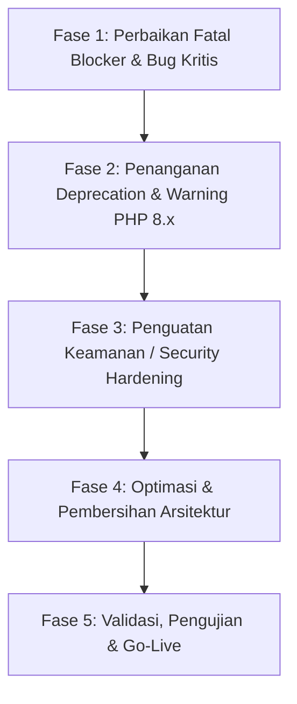

# Implementation Plan: Migrasi & Peningkatan Kualitas SINAIK (PHP 8.2 – 8.4)

Rencana kerja ini disusun secara sistematis dan bertahap untuk membawa basis kode aplikasi **SINAIK** dari lingkungan PHP 7.2 agar sepenuhnya kompatibel, stabil, dan aman di lingkungan **PHP 8.2, PHP 8.3, dan PHP 8.4**.

---

## 1. Ikhtisar Strategi & Tahapan Pekerjaan

Pekerjaan perbaikan dibagi menjadi 5 fase berurutan untuk meminimalkan risiko regresi:



---

## 2. Rincian Fase Implementasi

### Fase 1: Perbaikan Fatal Blocker & Bug Kritis (Penyebab Crash)
Tujuan: Memastikan aplikasi tidak langsung crash (HTTP 500 / Fatal Error) saat dijalankan di PHP 8.2 – 8.4.

| No | Komponen / File | Masalah Saat Ini | Rencana Perbaikan |
|---|---|---|---|
| 1.1 | `config/config.php` | Di PHP 8.1+, MySQLi melempar `mysqli_sql_exception` yang membuat web crash jika ada query gagal. | Tambahkan `mysqli_report(MYSQLI_REPORT_OFF);` sebelum inisialisasi koneksi untuk mempertahankan stabilitas alur kode prosedural. |
| 1.2 | `admin/pengajuan/delber.php`<br>`kepala/pengajuan/delber.php` | Meng-include `../../_config/config.php` (folder tidak ada), menyebabkan `$link` bernilai `null` dan melempar `TypeError: mysqli_query()` di PHP 8.0+. | Ubah path include menjadi `../../config/config.php` dan pastikan nama tabel query sesuai (`tpendukung`). |
| 1.3 | `config/menu/add.php` | Pemanggilan fungsi usang `mysql_error()` yang memicu `Fatal error: Call to undefined function`. | Hapus atau ganti menjadi `mysqli_error($link)`. |
| 1.4 | `logout.php` | Membaca `$_SESSION['Npeg']` & `$_SESSION['username']` yang belum tentu ada, memicu `E_WARNING: Undefined array key`. Output warning ini membatalkan fungsi `header("Location: login.php")`. | Hapus baris pemanggilan mentah, gunakan `unset()` secara aman dan pastikan `session_destroy()` berjalan sebelum `header()`. |
| 1.5 | `admin/pengajuan/proses.php`<br>`kepala/pengajuan/proses.php` | Menggunakan konkatenasi string `if ($tambah . $ubah)` yang berisiko fatal jika mengembalikan objek result. | Ganti dengan operator logika boolean standar `if ($tambah && $ubah)`. |
| 1.6 | `admin/pegawai/proses.php`<br>`kepala/pegawai/proses.php` | Logika update pegawai menimpa nama file foto dengan timestamp kosong jika pengguna tidak memilih foto baru. | Pisahkan query update: update foto hanya dijalankan jika file baru benar-benar diunggah (`!empty($_FILES['gbr']['name'])`). |

---

### Fase 2: Standarisasi Tipe Data & Penanganan Warning / Deprecation
Tujuan: Menghilangkan seluruh `Deprecated` notice dan `Warning` pada PHP 8.1 – 8.4 yang dapat mencemari output HTML dan memicu masalah UI.

| No | Komponen / File | Masalah Saat Ini | Rencana Perbaikan |
|---|---|---|---|
| 2.1 | `config/ceklogin.php` | Jika login gagal, `$data` bernilai `null`, memicu 8 peringatan `Warning: Trying to access array offset on value of type null`. | Tambahkan pengecekan `$query->num_rows > 0` sebelum melakukan `fetch_array()` dan mengakses properti data. |
| 2.2 | Seluruh file cetak & dashboard:<br>`admin/dashboard/index.php`<br>`admin/skpensiun/lskpen.php`<br>`admin/skpensiun/cetak.php` | `date('d-m-Y', strtotime($row['tgl']))` melempar `TypeError` jika `strtotime()` mengembalikan `false` atau melempar deprecation jika parameter bernilai `null`. | Buat fungsi helper terpusat `format_tgl($tgl, $format = 'd-m-Y')` di `config/config.php` yang melakukan pengecekan `!empty()` sebelum melakukan `strtotime()` dan `date()`. |
| 2.3 | `admin/pensiun/proses.php`<br>`pegawai/pengajuan/psub.php` | Fungsi string bawaan (`htmlentities()`, `explode()`, `trim()`) melempar *Deprecated* jika menerima nilai `null`. | Terapkan operator null-coalescing PHP modern: `htmlentities($_POST['noSer'] ?? '', ENT_QUOTES)`. |
| 2.4 | Seluruh file form edit (`update.php`, `del*.php`) | Mengakses `$_GET['id']` secara langsung tanpa validasi keberadaan parameter. | Bungkus dengan `isset($_GET['id'])` atau fallback `$_GET['id'] ?? null` dengan pengalihan aman jika parameter tidak tersedia. |

---

### Fase 3: Penguatan Keamanan Sistem (Security Hardening)
Tujuan: Menutup celah kerentanan kritis yang teridentifikasi selama audit.

> [!CAUTION]
> Basis kode saat ini memiliki celah **SQL Injection massal** di hampir seluruh query CRUD serta penggunaan enkripsi password lama (`md5`). Sangat disarankan untuk dieksekusi bersamaan dengan migrasi versi PHP.

| No | Target Keamanan | Kondisi Saat Ini | Rencana Perbaikan |
|---|---|---|---|
| 3.1 | **Proteksi SQL Injection** | Parameter `$_POST` dan `$_GET` langsung digabungkan ke string query SQL. | Migrasi secara bertahap ke *Prepared Statements* menggunakan `$stmt = $link->prepare(...)` dan `$stmt->bind_param(...)`. |
| 3.2 | **Password Hashing** | Password disimpan menggunakan hash usang `md5($pass)`. | Ganti ke algoritma standar PHP modern: `password_hash($pass, PASSWORD_BCRYPT)` saat pendaftaran/ubah password, dan verifikasi dengan `password_verify($pass, $hash)` pada login. |
| 3.3 | **Validasi Upload Berkas** | Di `admin/pensiun/proses.php`, validasi hanya memeriksa ekstensi nama file asli tanpa sanitasi nama dan MIME type. | 1. Gunakan nama file acak/unik (`uniqid() . '.pdf'`).<br>2. Validasi MIME type sebenarnya dengan `mime_content_type($file_tmp) === 'application/pdf'`.<br>3. Batasi ukuran maksimal file (misal: maks 5MB). |
| 3.4 | **Pencegahan XSS (Cross-Site Scripting)** | Nilai variabel dicetak langsung menggunakan `<?= $row['...'] ?>`. | Terapkan sanitasi output dengan `htmlspecialchars($data, ENT_QUOTES, 'UTF-8')`. |
| 3.5 | **Keamanan Session** | Session ID tidak diperbarui setelah login sukses (*Session Fixation risk*). | Tambahkan `session_regenerate_id(true)` di `config/ceklogin.php` saat otentikasi berhasil. |

---

### Fase 4: Optimasi & Perapian Arsitektur
Tujuan: Menghilangkan redundansi kode, memperbaiki performa query, dan merapikan struktur file.

- [ ] **Koleksi Helper Terpusat**: Tambahkan fungsi helper di `config/config.php`:
  - `format_tgl($tgl, $format)`: Pemformat tanggal aman anti-crash.
  - `escape($str)`: Helper pembersih string input.
  - `clean_output($str)`: Helper anti-XSS.
- [ ] **Optimasi Query Dashboard**: Di `admin/dashboard/index.php`, satukan query `SELECT count(*)` yang terpisah menjadi agregasi yang lebih efisien atau pertahankan indeks database pada kolom filter (`jNs`, `sT`).
- [ ] **Eliminasi Kode Mati**: Bersihkan variabel `$bln` yang tidak dipakai dan komentar debug lama yang tidak relevan.

---

### Fase 5: Rencana Pengujian & Validasi

```markdown
## Checklist Verifikasi Kompatibilitas PHP 8.2 - 8.4

### Validasi Statis (Linter)
- [ ] Jalankan `php -l` pada seluruh file PHP di bawah binary PHP 8.2/8.3/8.4.
- [ ] Pastikan tidak ada pesan syntax error atau fatal error.

### Validasi Alur Fungsional (Manual Testing)
- [ ] **Autentikasi**:
  - [ ] Login berhasil sebagai Admin, Pegawai, dan KADIS.
  - [ ] Login gagal (password salah) tidak memicu Warning offset null.
  - [ ] Logout berhasil dan redirect ke `login.php` tanpa pesan header error.
- [ ] **Modul Pegawai**:
  - [ ] Tambah pegawai baru (dengan foto).
  - [ ] Edit pegawai tanpa mengganti foto (foto lama tidak boleh hilang/terhapus).
  - [ ] Hapus data pegawai.
- [ ] **Modul Pengajuan Kenaikan Pangkat**:
  - [ ] Tambah pengajuan dan verifikasi berkas.
  - [ ] Persetujuan pengajuan dan pembuatan nomor SK.
  - [ ] Cetak SK Kenaikan Pangkat.
- [ ] **Modul Pensiun**:
  - [ ] Pengajuan pensiun reguler & pensiun dini.
  - [ ] Unggah berkas dokumen pendukung (PDF validasi).
  - [ ] Cetak SK Pensiun dan laporan pensiun.
- [ ] **Konfigurasi Server Produksi**:
  - [ ] `display_errors = Off` di php.ini.
  - [ ] `log_errors = On` dengan error_log terpantau bersih dari Warning/Deprecated.
```

---

## 3. Catatan dan Keputusan Pengguna (User Decisions)

Sebelum eksekusi teknis dimulai, silakan tinjau beberapa poin opsi implementasi berikut:

1. **Strategi Penanganan SQL Injection**:
   - *Opsi A (Rekomendasi Cepat)*: Mengamankan parameter dengan `real_escape_string()` dan validasi tipe int `(int)$_GET['id']` pada query yang ada.
   - *Opsi B (Rekomendasi Ideal)*: Mengubah seluruh query manipulasi data ke `mysqli_stmt` (*Prepared Statements*).
2. **Strategi Hashing Password**:
   - Menggunakan fallback backward compatibility: Jika password di database masih berupa MD5 (panjang 32 karakter), sistem melakukan verifikasi MD5 lalu otomatis meng-upgrade hash ke `password_hash()` saat user berhasil login.
